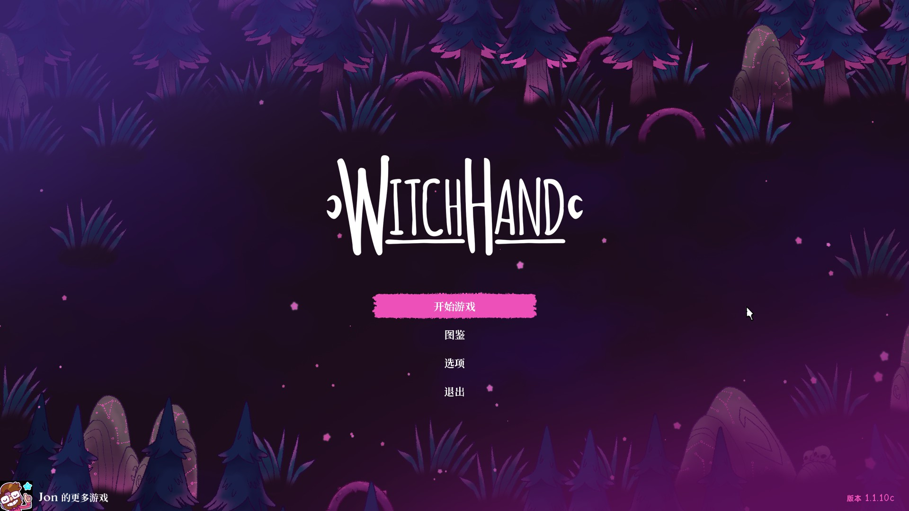
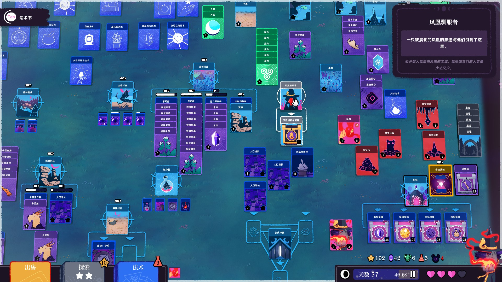
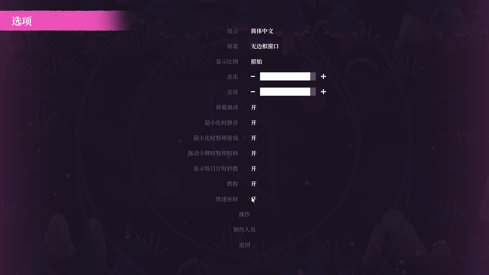

# WitchHand 简体中文汉化补丁

非官方简体中文汉化补丁，适用于 Steam 版 **WitchHand（女巫之手）**（appid 2420880）。

- 当前版本：**1.1**（2026-10-23）
- 支持游戏版本：**1.10c**（主菜单右下角显示）
- 平台：Windows / Steam

## 截图

截图来自 1.1 汉化版（游戏版本 1.10c）。

| 主菜单 | 卡牌与悬浮说明 |
| :---: | :---: |
|  |  |

| 图鉴 | 选项 |
| :---: | :---: |
|  |  |

## 下载

前往 [Releases](https://github.com/rosabelll/WitchHand-CN/releases/latest) 下载最新补丁压缩包。

> 本仓库不包含游戏本体。请先通过 Steam 购买并安装正版游戏。

## 安装

1. 完全退出游戏（包括 Steam 后台的 WitchHand 进程）。
2. 从 Releases 下载并完整解压压缩包（请保留整个文件夹）。
3. 双击 `install.bat`。
   - 安装器会自动从 Steam 库中查找游戏目录；
   - 如果找不到，会提示粘贴 WitchHand 文件夹路径；
   - 也可在命令提示符中运行：`install.bat -GameDir "D:\你的路径\WitchHand"`。
4. 首次安装会把 16 个原文件备份到 `backup\install_original`，然后安装汉化。
5. 启动游戏即可。游戏语言保持默认 English，不需要切换。

也可以直接克隆本仓库，在仓库目录运行 `install.bat`。

## 卸载

双击 `uninstall.bat`，会从 `backup\install_original` 还原全部 16 个原文件（含 `data.win`、12 个 `.yy`、2 个 CSV、`WitchHand.exe`）。

请保留 `backup` 文件夹直到确认不再需要卸载。如果备份丢失，可在 Steam 中右键游戏 → 属性 → 已安装文件 → 验证游戏文件完整性，恢复英文原版。

## 汉化内容

- 界面文本 293 条：标题菜单、设置、教程提示、卡牌提示、结局文本等。
- 卡牌文本 483 张：卡名、说明、风味文本。
- 游戏内 12 种字体补充中文字形（最多 1538 个字符，含标点与一个不可见占位符）。
- 直接写死在程序里的 4 句操作提示。
- 语言栏 English 一列显示为中文；德语、波兰语、法语内容未改动。

1.1 修复了长卡名悬浮提示标题最后一个字换行、错位的问题（如“炼金术士”“妖精城市”“水晶采石场”）。

为避免破坏按键设置，以下内容保留英文：

- 按键名称：LMB / MMB / RMB / Space / Tab / Backspace / On
- 提示框标题：Sell / Explore / Spells
- 开发者名字：Jon

## 注意事项

- Steam 的“验证游戏文件的完整性”或游戏更新会覆盖汉化，重新运行 `install.bat` 即可。
- 游戏更新后 `data.win` 哈希会变化，本补丁会拒绝安装，请等待对应版本的更新。
- 本补丁只支持简体中文；游戏语言需保持默认 English。
- 汉化不修改存档。存档位置：`C:\Users\<用户名>\AppData\Local\WitchHand`。
- Steam 云同步只同步存档，不会同步汉化文件。
- 安装器需要调用 `tools\zstd.exe` 应用补丁。个别杀毒软件可能误报，请将解压目录加入信任后重试。
- `data.win` 与 12 个 `.yy` 字体文件必须成对安装（安装器已处理）。游戏运行时从 `.yy` 读取字形布局，只替换其中一部分会导致字符错位。

## 技术信息

补丁通过对原版 `data.win` 做 zstd 差分生成，只包含差异和新增的中文字形，不包含完整游戏文件。

| 文件 | SHA-256 |
| --- | --- |
| 原版 `data.win`（1.10c） | `7417130ACBBBD9C369732644B03DF385B78AA6AAA8ABC6C8862CC718AC2FC072` |
| 汉化后 `data.win` | `61C0680CC716AFDF29D194E155E3371FDAF6B0E8160B8128B6754501E6DDABFC` |
| 补丁 `witchhand_1.1.data.zst` | `6B6E57248D01A3A8BE75E0E376BE8549CC06E699B1F3F75671B2135F218996FF` |

安装器会校验补丁文件、原版 `data.win` 和安装结果三处哈希；版本不符时不会修改任何文件。

发布包 `WitchHand_CN_1.1_patch.zip` 的 SHA-256：

```
2DC2B38790FC2AB30AB3AF9957EB066107BF88AA1605F4EB16817027B7F5C331
```

## 目录结构

```
install.bat              安装（双击）
uninstall.bat            卸载 / 还原（双击）
install.ps1              安装脚本本体
README.txt               随包说明
NOTICE.txt               致谢与第三方许可证
SHA256SUMS.txt           包内文件校验值
payload\data.win 差分补丁、12 个 .yy、2 个 CSV
tools\zstd.exe           补丁引擎（zstd 1.5.7）
```

## 致谢与许可

- 本汉化为非官方粉丝作品，与 WitchHand 开发者无关。
- 游戏本体及素材版权归原作者所有，请支持正版。
- 字体：Noto Serif SC（SIL Open Font License 1.1）、阿里巴巴普惠体 Bold（免费商用，版权归阿里巴巴集团）。本补丁只包含渲染后的字形位图，不包含字体文件。
- zstd 1.5.7：BSD-3-Clause，许可证见 [tools/zstd-LICENSE.txt](tools/zstd-LICENSE.txt)。
- 分析/打包使用了 UndertaleModTool 与 Scribble，均未随包分发。
- 详细致谢与许可证见 [NOTICE.txt](NOTICE.txt)。
- 本仓库中由项目作者编写的安装脚本与原创代码以 [MIT 许可证](LICENSE) 发布；汉化文本仅供搭配正版游戏使用，游戏与字体的权利归各自所有者。

## 反馈

遇到问题请通过 [Issues](https://github.com/rosabelll/WitchHand-CN/issues) 反馈，并附上游戏版本、错误提示和截图。请勿在 Issue 中上传游戏本体文件。
